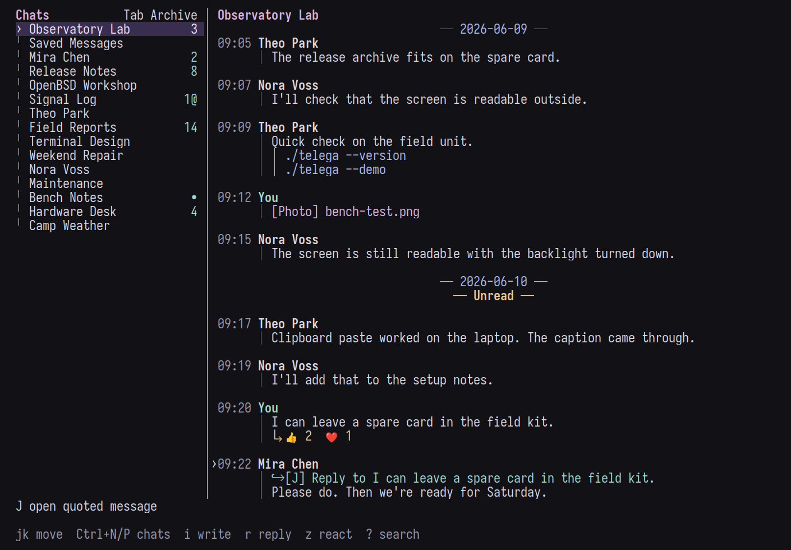

# telega

Telegram for the terminal. Catch up on chats, search conversations, and reply with Vim-style navigation on Linux and OpenBSD.

[Download telega](#install) · [Release notes and checksums](https://github.com/danilrwx/telega/releases/latest)


*Offline demo from the current source tree.*

## Install

Pick a prebuilt archive. The OpenBSD ARMv7 build is the one to try on a Pomera DM250.

| System | amd64 | ARM64 | ARMv7 |
| --- | --- | --- | --- |
| Linux | [Download](https://github.com/danilrwx/telega/releases/latest/download/telega_linux_amd64.tar.gz) | [Download](https://github.com/danilrwx/telega/releases/latest/download/telega_linux_arm64.tar.gz) | [Download](https://github.com/danilrwx/telega/releases/latest/download/telega_linux_armv7.tar.gz) |
| OpenBSD | [Download](https://github.com/danilrwx/telega/releases/latest/download/telega_openbsd_amd64.tar.gz) | [Download](https://github.com/danilrwx/telega/releases/latest/download/telega_openbsd_arm64.tar.gz) | [Download](https://github.com/danilrwx/telega/releases/latest/download/telega_openbsd_armv7.tar.gz) |

Extract your archive and start the offline demo. Replace the filename below with the one you downloaded.

```sh
tar -xzf telega_linux_amd64.tar.gz
./telega --demo
```

The demo uses sample chats and needs no Telegram account or network connection. Follow the hints at the bottom of the screen.

To install it for your user account, put the binary in a directory on your `PATH`, such as `~/.local/bin`.

```sh
install -d "$HOME/.local/bin"
install -m 755 telega "$HOME/.local/bin/telega"
```

## Sign in

1. Get your `api_id` and `api_hash` under **API development tools** at [my.telegram.org](https://my.telegram.org).
2. Run `./telega` and enter those values when prompted.
3. In Telegram on your phone, open **Settings → Devices → Link Desktop Device** and scan the QR code. For phone-number sign-in, use `./telega --phone`.

## What you can do

- **Catch up quickly.** Switch chats without leaving the conversation view, jump to unread messages, and browse archives, forum topics, and channel comments. History loads in pages.
- **Keep context in view.** Read formatted messages, dates, replies, and reactions. Search both the loaded conversation and Telegram history, or follow a reply or forwarded source.
- **Write from the keyboard.** Send multiline messages and code, paste a screenshot with a caption, or select several messages to forward or delete. Failed sends keep their drafts while the client is running.

The interface works in a text console with ANSI colors and text labels for reactions. In tmux, notifications highlight the window when bell monitoring is enabled. Desktop integration adds clipboard images, system openers, and desktop alerts where supported.

## Your account and data

telega connects directly to Telegram over MTProto through [gotd](https://github.com/gotd/td). Your API credentials and reusable session are stored in private files under `${XDG_DATA_HOME:-$HOME/.local/share}/telega`. Notifications show who or which chat they came from when available and keep message text out of the alert.

telega is open source under the [Apache License 2.0](LICENSE). GitHub Actions runs the tests and publishes SHA-256 checksums alongside the [release archives](https://github.com/danilrwx/telega/releases/latest).

## Build from source

Use Go 1.26 or later and `make`. Run `make` for your system or `make dm250` to cross-build for OpenBSD/ARMv7. See [CONTRIBUTING.md](CONTRIBUTING.md) for development and release commands.
