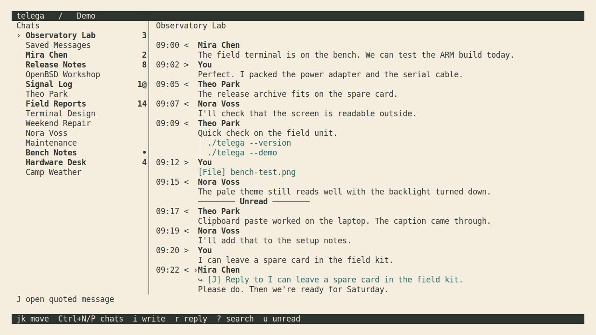

# telega

A keyboard-driven Telegram client for Linux and OpenBSD. It connects to a personal account over MTProto through [gotd](https://github.com/gotd/td). The interface keeps up to 96 messages from the current conversation in memory and loads history in pages.



## Install

Download the archive for your OS and architecture from [GitHub Releases](https://github.com/danilrwx/telega/releases). The releases include Linux and OpenBSD builds for amd64, arm64, and ARMv7, with SHA-256 checksums. For a Pomera DM250 running OpenBSD, use `telega_openbsd_armv7.tar.gz`.

```sh
tar -xzf telega_linux_amd64.tar.gz
install -d "$HOME/.local/bin"
install -m 755 telega "$HOME/.local/bin/telega"
telega --demo
```

Use the demo to try the interface offline. For an account, get your `api_id` and `api_hash` from **API development tools** at [my.telegram.org](https://my.telegram.org). On first launch, telega prompts for the pair and saves it under `${XDG_DATA_HOME:-$HOME/.local/share}/telega/api`. You can also supply `TELEGA_API_ID` and `TELEGA_API_HASH` together as environment variables.

Run `telega --qr` and scan the QR code using **Settings → Devices → Link Desktop Device** on your phone. Or run `telega` and enter your international phone number and the code Telegram sends. Either flow may ask for your two-step verification password. The session is stored privately as `gotd.session` in the same data directory.

## Keys

| Where | Keys | Action |
| --- | --- | --- |
| Chat list | `j` / `k`, `l` | Select and open a chat |
| Chat list | `/`, `u` / `U`, `r` | Filter, find the next or previous unread chat, or refresh |
| Any chat | `Ctrl+N` / `Ctrl+P` | Open the next or previous chat and keep the current draft |
| Conversation | `j` / `k`, `Ctrl+U` / `Ctrl+D`, `gg` / `G` | Select a message, page, or jump to the oldest loaded or newest message |
| Conversation | `/`, `?`, `n` / `N` | Search loaded messages, search chat history on Telegram, or navigate matches |
| Conversation | `u`, `m`, `h` | Go to the first unread message, mark through the cursor as read, or return to chats |
| Conversation | `i`, `e`, `r` / `R` | Compose, edit your message, or reply with text or an image |
| Conversation | `J`, `F`, `Ctrl+O` | Open the quoted message, open the forwarded source when available, or jump back |
| Conversation | `y`, `v`, `o` / `O` | Copy text, reveal spoilers, or open an attachment or link |
| Conversation | `Space`, `f`, `d` / `D` | Select multiple messages, forward, or request deletion for yourself or for everyone |
| Conversation | `a`, `Ctrl+V` / `s` | Attach an image or paste a screenshot from the clipboard |
| Conversation | `S` | Take a screenshot of a selected region on Wayland |
| Composer | `Enter`, `Ctrl+J`, `Ctrl+S`, `Esc` | Send, add a line, save a draft and return to chats, or cancel |

Normal-mode shortcuts work with the English and Russian layouts. Messages and search fields accept the text you type. Terminal paste (often `Ctrl+Shift+V`) keeps line breaks and indentation. Use triple backticks on their own lines to send a code block. A language can follow the opening backticks.

At the latest messages in a focused chat, incoming messages are marked as read, including while you compose. History loads in advance when about half the conversation pane is empty. The selected message stays in place. Timestamps are in UTC. Numeric badges indicate unread counts, `@` indicates mentions, and a dot indicates a manual unread mark.

- Forwarding and deletion ask for confirmation. Telegram applies channel and supergroup deletion to everyone.
- Pasting a screenshot from the clipboard uses `wl-paste` on Wayland or `xclip` on X11. When you paste while composing, your draft becomes the caption.
- To take a screenshot from inside telega on Wayland, press `S` to select a region. This optional shortcut uses `slurp` and `grim`.
- Copying uses `wl-copy`, `xclip`, or OSC 52 when supported by the terminal. Downloads go to the private `telega/attachments` directory in the system cache and open through `open` or `xdg-open`.
- Desktop notifications use `notify-send` when available, with the terminal bell as a fallback.

## Build

Use Go 1.26 or later and `make`. The build uses one compiler worker and disables cgo. CI uses Go 1.27.3.

```sh
make
make check
./telega --demo
```

Run `make dm250` to cross-build `telega-dm250` for OpenBSD/ARMv7. Building on a faster machine can help on the Pomera because compiling the generated Telegram schema takes considerably more memory than running the client.

See [CONTRIBUTING.md](CONTRIBUTING.md) for the lint and release commands. telega is licensed under the [Apache License 2.0](LICENSE).
