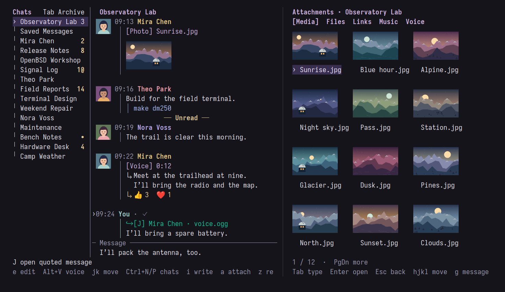

# Telega

**Telegram for your terminal.** Catch up on unread chats, find anything in your history, and reply with Vim-style keys. Runs on macOS, Linux, and OpenBSD, including the Pomera DM250.

**About 13 MiB of RAM** in the text-mode chat demo on Linux x86-64. [Memory measurements](docs/memory.md)

## Install

```sh
curl -fsSL https://raw.githubusercontent.com/danilrwx/telega/main/scripts/install.sh | sh
```

The installer picks the right build, checks its SHA-256 hash, and installs it to `~/.local/bin`. [Download an archive instead](https://github.com/danilrwx/telega/releases/latest).

```sh
~/.local/bin/telega --demo
```

Try sample chats offline before signing in.



## What you can do

- **Keep up with chats.** Filter to unread conversations, jump to a chat by name or username, and search messages across your chats.
- **Reply from the keyboard.** Quote messages, add reactions, and write longer replies in Vim or your preferred editor. Drafts are saved when you quit.
- **Browse shared media.** Find photos, files, and links in a chat’s gallery, then jump to the original message. Kitty and Sixel terminals show image previews inline.

## Sign in

Get your API ID and hash from **API development tools** at [my.telegram.org](https://my.telegram.org). Run `~/.local/bin/telega` and scan the QR code in Telegram under **Settings → Devices → Link Desktop Device**. Use `--phone` for phone-number sign-in.

[Keyboard shortcuts and setup](https://github.com/danilrwx/telega/blob/main/docs/usage.md) · [Releases](https://github.com/danilrwx/telega/releases) · [Build from source](https://github.com/danilrwx/telega/blob/main/CONTRIBUTING.md)
