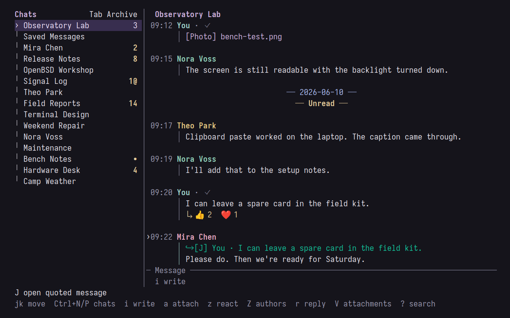

# telega

Telegram for the terminal. Catch up on chats, search conversations, and reply with Vim-style navigation on Linux and OpenBSD.

[Download telega](#install) · [Release notes and checksums](https://github.com/danilrwx/telega/releases/latest)


*Offline demo from the current source tree.*

## Install

Pick a prebuilt archive. The OpenBSD ARMv7 build is the one to try on a Pomera DM250.

| System | amd64 | ARM64 | ARMv7 |
| --- | --- | --- | --- |
| Linux | [Download](https://github.com/danilrwx/telega/releases/latest/download/telega_linux_amd64.tar.gz) | [Download](https://github.com/danilrwx/telega/releases/latest/download/telega_linux_arm64.tar.gz) | [Download](https://github.com/danilrwx/telega/releases/latest/download/telega_linux_armv7.tar.gz) |
| OpenBSD | [Download](https://github.com/danilrwx/telega/releases/latest/download/telega_openbsd_amd64.tar.gz) | [Download](https://github.com/danilrwx/telega/releases/latest/download/telega_openbsd_arm64.tar.gz) | [Download](https://github.com/danilrwx/telega/releases/latest/download/telega_openbsd_armv7.tar.gz) |

Extract your archive and start the offline demo. Replace the filename below with the one you downloaded.

```sh
tar -xzf telega_linux_amd64.tar.gz
./telega --demo
```

The demo uses sample chats and needs no Telegram account or network connection. Follow the hints at the bottom of the screen.

To install it for your user account, put the binary in a directory on your `PATH`, such as `~/.local/bin`.

```sh
install -d "$HOME/.local/bin"
install -m 755 telega "$HOME/.local/bin/telega"
```

## Sign in

1. Get your `api_id` and `api_hash` under **API development tools** at [my.telegram.org](https://my.telegram.org).
2. Run `./telega` and enter those values when prompted.
3. In Telegram on your phone, open **Settings → Devices → Link Desktop Device** and scan the QR code. For phone-number sign-in, use `./telega --phone`.

## What you can do

- **Catch up quickly.** Switch chats from the conversation view, filter the chat list to unread chats, and browse archives, forum topics, and channel comments. History loads in pages.
- **Keep context in view.** Read formatted messages, dates, replies, and reactions. Search both the loaded conversation and Telegram history, or follow a reply or forwarded source.
- **Write from the keyboard.** The composer stays visible in the chat pane and grows up to half the window. Press `i` to type, `Ctrl+X` to edit the draft in Vim, and `Esc` to return to navigation. Text drafts stay on this computer and reopen with their chat or topic, even after restarting. You can send multiline messages and code, paste screenshots, and retry failed sends.

The interface works in a text console with ANSI colors and text labels for reactions. In tmux, notifications highlight the window when bell monitoring is enabled. Desktop integration adds clipboard images, system openers, and desktop alerts where supported.

Set `TUI_CHAT_STATUS_FILE` to an optional path (in an existing directory) for a status-bar integration. Telega writes `unread mentions` on one line: the number of unread chats, including manually marked chats, and the total unread mentions on the currently loaded Telegram dialog page. This is not an account-wide count and ignores local search and unread-only filters. The file is refreshed while the client runs, including while tmux is detached, and removed when status is unavailable or on normal exit. With status publishing enabled in tmux, telega only auto-marks messages read if its pane is active in an attached session.

Videos show their duration, size, and resolution when Telegram provides them. Opened attachments are cached under `${XDG_CACHE_HOME:-$HOME/.cache}/telega/attachments` for reuse across sessions.

Press `z` to react. Use `←` and `→` to browse reactions already on the message, and `Enter` to add your own. Press `Shift+Z` to see who reacted when Telegram makes the list available.

Press `a` in the chat or `Alt+A` while composing to open the file picker. Use the arrows to choose, `Tab` to complete the path, and `Enter` to open a directory or attach a file. Use `Ctrl+T` in the picker or `Alt+T` in the chat to turn draft text into an attachment in Vim. Enter a filename with any extension, or press `Enter` to use `message.txt`. `Ctrl+O` opens draft attachments. Press `a` to add, `e` to edit a copy in Vim, `d` to remove, or `Enter` to open. `V` lists attachments in the loaded conversation.


## Your account and data

telega connects directly to Telegram over MTProto through [gotd](https://github.com/gotd/td). Your API credentials and reusable session are stored in private files under `${XDG_DATA_HOME:-$HOME/.local/share}/telega`. Notifications show who or which chat they came from when available and keep message text out of the alert.

telega is open source under the [Apache License 2.0](LICENSE). GitHub Actions runs the tests and publishes SHA-256 checksums alongside the [release archives](https://github.com/danilrwx/telega/releases/latest).

## Build from source

Use Go 1.26 or later and `make`. Run `make` for your system or `make dm250` to cross-build for OpenBSD/ARMv7. See [CONTRIBUTING.md](CONTRIBUTING.md) for development and release commands.

### Реакции и изображения

`z` открывает быстрые реакции. `Tab` показывает доступные для чата реакции. Введите имя или эмодзи, выберите стрелками и нажмите `Enter`. Повторный выбор снимает реакцию. Число реакций на одном сообщении зависит от лимита Telegram.

С Kitty или Sixel миниатюры вложенных изображений видны под сообщениями, а пользовательские реакции со статической картинкой отображаются рядом со счётчиком. Нажмите `o`, чтобы открыть фото крупнее. Повторное `o` открывает его в системном просмотрщике. `Ctrl+O` в каталоге реакций показывает статическую картинку выбранной пользовательской реакции, если Telegram её отдаёт. `Esc` закрывает просмотр.

Графика включается автоматически в Kitty и Foot. Для другого терминала с поддержкой Sixel запустите клиент с `TUI_GRAPHICS=sixel`. `TUI_GRAPHICS=off` отключает графику. В tmux автоматический выбор Sixel требует поддержки Sixel в сборке tmux и на внешнем терминале.
