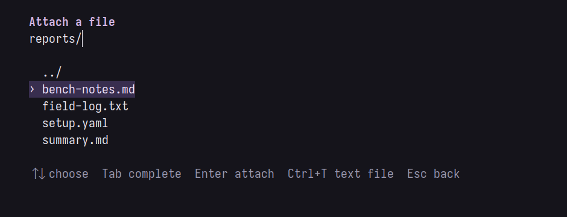

# Using Telega

[Install Telega](../README.md#install) and run `~/.local/bin/telega --demo` to try the keyboard controls offline.

## Chats and search

| Keys | Action |
| --- | --- |
| `j` / `k`, `l` / `h` | Move, open, and go back |
| `Ctrl+N` / `Ctrl+P` | Switch chats |
| `f`, `Tab` in the chat list | Filter unread chats or switch to the archive |
| `Ctrl+K` | Find a chat by its display name or `@username`, including archived chats |
| `?` / `Ctrl+F` | Search this chat or topic / all chats |
| `Tab`, `Shift+Tab` in search | Change the scope or cycle through messages, photos, files, links, and voice messages |
| `Enter`, `PgDn` in search | Search or open a result, then load more results as needed |

Press `Enter` with an empty query in a media filter to browse its results. History loads in pages in chats, forum topics, and channel comments.

Press `x` on a chat to pin or unpin it, toggle its notifications, or copy its public link if it has one. Inside a chat, the same menu lists pinned messages and lets you pin or unpin the selected message. Choose a pin with `Enter` to jump to it.

## Compose and attach

| Keys | Action |
| --- | --- |
| `i`, `Esc` | Start writing or leave the composer and keep the draft |
| `Ctrl+J`, `Enter` | Add a line or send |
| `Ctrl+A` / `Ctrl+E` | Move to the start / end of the current line |
| `Ctrl+W` | Delete the word to the left without joining lines |
| `Ctrl+G` | Remove the reply target without clearing the draft |
| `Ctrl+X` | Open the draft in `$VISUAL`, `$EDITOR`, or Vim |
| `Ctrl+V` | Paste text or a desktop screenshot |
| `a` / `Alt+A` | Pick a file from the chat or composer |
| `Alt+T` / `Ctrl+T` in the picker | Create a text attachment in your editor |
| `Ctrl+O` in the composer | Open the draft’s attachments |

Drafts stay on this computer and reopen with their chat or topic. The composer grows up to half the window.

In the file picker, choose with the arrows, complete paths with `Tab`, and open a folder or attach a file with `Enter`. For text attachments, enter a filename with an extension so your editor can detect its type. `Enter` accepts the default `message.txt`.

In the draft attachment list, use `a` to add, `e` to edit a copy, `d` to remove, or `Enter` to open.

## Channel comments

Select a channel post marked `[c] Comments` and press `c` to open its discussion. Press `i` to write a comment on the post, or select a comment and press `r` to reply to it. Press `Enter` to send. Replies to comments appear indented, and `J` jumps to the message they reply to. Press `h` or `Esc` outside the composer to return to the post.

## Media and reactions

- **Gallery** — `V` opens the chat’s full media history. `Tab` switches between media, files, links, music, and voice messages. Move with the arrows or `hjkl`, load older items with `PgDn`, open with `Enter`, or jump to the message with `g`.
- **Photos and attachments** — `o` opens the selected attachment. For an image preview, press `o` again to open the system viewer or `Esc` to close it. Video details appear when Telegram provides them. Downloads are cached under `${XDG_CACHE_HOME:-$HOME/.cache}/telega/attachments`.
- **Reactions** — `z` opens quick reactions, `←` / `→` browse reactions already on the message, and `Tab` opens the catalog. Choose with `Enter` and choose again to remove. `Shift+Z` shows who reacted when Telegram provides the list. `Ctrl+O` previews an available custom emoji in the catalog.

Kitty and Sixel terminals can show inline attachments, gallery thumbnails, avatars, and custom reactions. Telega detects graphics in Kitty and Foot. Use `TUI_GRAPHICS=sixel` to select Sixel explicitly or `TUI_GRAPHICS=off` to disable graphics. Sixel in tmux requires support from both tmux and the outer terminal.

## Voice messages

| Keys | Action |
| --- | --- |
| `Alt+V` | Record from the default microphone |
| `Enter` / `Alt+V`, `Esc` while recording | Keep the recording as a draft or discard it |
| `o` in chat or `Enter` in the gallery or draft | Play a voice recording |
| `Alt+P`, `Alt+Shift+P` | Pause or resume, or stop |
| `Alt+R` | Open Telegram’s transcript of a sent voice message |

Press `Enter` again after recording to send. To listen first, open draft attachments with `Ctrl+O`. During the current session, completed transcripts also appear below the voice message. Telegram generates the text subject to the account’s transcription limits. Scroll long transcripts with `j` / `k` or `PgUp` / `PgDn`.

Recording and playback need FFmpeg with PulseAudio support, including PipeWire’s PulseAudio service. Recording also needs FFmpeg’s libopus encoder.

## Settings and tmux

Open settings with `Alt+S`, move with `j` / `k` or the arrows, and change the selected setting with `Enter`. You can choose a full-width chat, show or hide names and avatars in direct messages, and right-align outgoing messages. Choices persist between sessions. Press `h` to return to the chat list.

The text console uses ANSI colors and text reaction labels. Desktop integration supports clipboard images, system openers, and notifications where available. With bell monitoring enabled, tmux can highlight windows with new Telegram alerts.

Set `TUI_CHAT_STATUS_FILE` to a path in an existing directory to publish `unread mentions` for a status bar. The counts cover the loaded dialog page, regardless of filters, and include chats marked unread manually. Telega updates the file while running, including when tmux is detached, and removes it when status is unavailable or on normal exit. With status publishing enabled inside tmux, Telega marks messages read automatically only when its pane is active in an attached session.

## Account and data

Telega connects directly to Telegram over MTProto through [gotd](https://github.com/gotd/td). It stores credentials and the reusable session in private files under `${XDG_DATA_HOME:-$HOME/.local/share}/telega`. Notifications can show the sender or chat but omit the message text.

See [CONTRIBUTING.md](../CONTRIBUTING.md) to build or cross-compile for the Pomera DM250. Telega is licensed under [Apache 2.0](../LICENSE).
